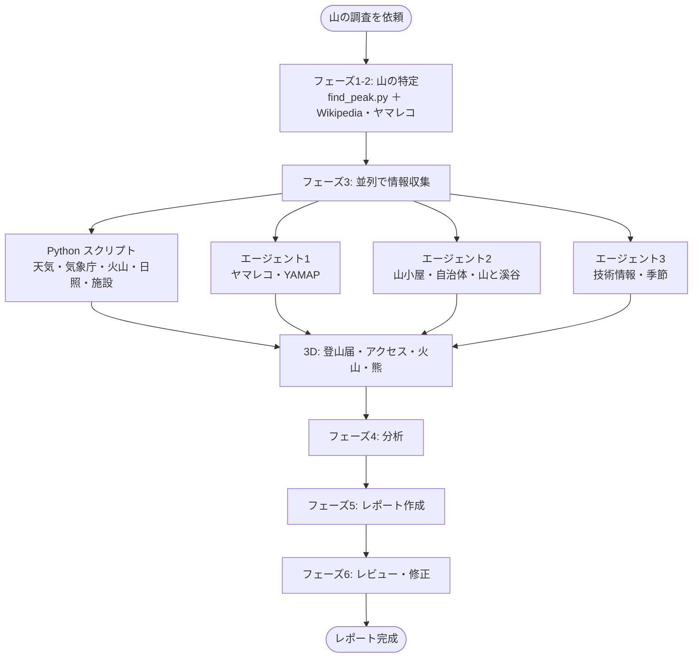

# 日本の山のルート調査スキル（Claude Code 用）

[claude-mountaineering-skills](https://github.com/dreamiurg/claude-mountaineering-skills)（北米の山向け）を、**日本の山・日本の情報源・日本の登山の慣習**に合わせて作り直した日本版です。

Claude に「槍ヶ岳を調べて」と頼むと、天気・警報・火山・日の出日の入り・山行記録・アクセス・登山届までをまとめた日本語の Markdown レポートを作ります。

## 元プロジェクトからの主な変更

| 項目 | 元（北米） | 日本版 |
|------|-----------|--------|
| 山の特定 | PeakBagger | OpenStreetMap の山頂 ＋ 国土地理院の地名検索（表記ゆれ・同名山に対応） |
| 天気 | Open-Meteo、NOAA | Open-Meteo（山頂標高・稜線の風・体感温度）＋ **気象庁の府県天気予報** |
| 警報 | — | **気象庁の警報・注意報**（2026年5月からの新体系 `data/r8/` に対応、市町村単位） |
| 雪崩 | NWAC | 気象庁のなだれ注意報 ＋ 日本雪崩ネットワーク |
| 火山 | — | **近くの火山の検出** ＋ 気象庁の噴火警戒レベルの確認手順 |
| 大気 | 米国 AQI | **PM2.5（環境省の注意喚起の目安）・黄砂** |
| 山行記録 | PeakBagger、WTA、Mountaineers | **ヤマレコ、YAMAP**、山小屋の公式情報、自治体・環境省 |
| 行政区分 | 郡（FCC） | **市町村**（地理院の逆ジオコーダ＋気象庁の地域コード） |
| 緊急連絡先 | 病院、レンジャーステーション | 病院、**警察署**、110/119 |
| 宿泊 | キャンプ場 | **山小屋・避難小屋**、テント場、キャンプ場 |
| 規制・手続き | 許可証、ゲート | **登山届（条例）**、マイカー規制、季節運行のバス、入山料・協力金、熊の出没情報 |
| 時間の目安 | Naismith 系（mi, ft） | DIN 33466（km, m）＋ **山本正嘉のコース定数**、エネルギー・脱水量の目安 |
| 行程 | 日没判定 | **早出早着**（15時到着の目安）＋日没判定 |
| 地図 | CalTopo、Gaia GPS | **地理院地図**、Google マップ、PeakVisor |
| 単位 | ft, mi, °F, mph | m, km, ℃, m/s |

## しくみ



情報源が1つ落ちても止まらず、「不明点」の節に書いて続けます。

## インストール

**必要なもの:** [Claude Code](https://docs.anthropic.com/en/docs/claude-code/overview)、[uv](https://docs.astral.sh/uv/)（Python ツール用）

### プラグインとして

このフォルダを GitHub のリポジトリに置いた場合:

```
/plugin marketplace add {あなたのGitHubユーザー名}/{リポジトリ名}
/plugin install yama@yama-marketplace
/reload-plugins
```

### スキルだけ

`skills/yama-route-researcher/` を `~/.claude/skills/` にコピーします。

```
cp -r skills/yama-route-researcher ~/.claude/skills/
cd ~/.claude/skills/yama-route-researcher/tools && uv sync
```

## 使い方

### コマンド（プラグインの場合）

| コマンド | 内容 |
|---------|------|
| `/yama:research <山名>` | ルート調査レポートを作る（3〜6分） |
| `/yama:conditions <山名>` | 天気・警報・火山・日照だけをすばやく確認（約1分） |
| `/yama:trip-reports <山名>` | ヤマレコ・YAMAP の最近の山行記録を要約 |

### 普通に頼む

```
「槍ヶ岳を調べて」
「11月に甲斐駒ヶ岳へ黒戸尾根から日帰りしたい。ルートを調べて」
「今週末の赤岳の状況は？」
```

レポートは作業ディレクトリに `YYYY-MM-DD-山名.md` で保存されます。

## ツールを直接使う

```bash
cd skills/yama-route-researcher/tools
uv run python find_peak.py "槍ヶ岳"
uv run python fetch_conditions.py --coordinates "36.3419,137.6476" --elevation 3180 --peak-name "槍ヶ岳" \
  --distance-km 40 --up-m 1700 --start-time 05:00
```

詳しくは [tools/README.md](skills/yama-route-researcher/tools/README.md)。

## 注意

- 気象庁の `bosai` JSON は公開仕様ではない内部データです。2026年5月28日の防災気象情報の新体系で警報の配信先が `data/r8/` に変わったように、予告なく変わることがあります。スクリプトはデータの鮮度を確認し、古ければ警告します。
- 生成されるレポートは計画の出発点です。最終的な判断は、公式情報と自分の経験に基づいて行ってください。

## ライセンス

[MIT](LICENSE)。元プロジェクト [claude-mountaineering-skills](https://github.com/dreamiurg/claude-mountaineering-skills)（© dreamiurg、MIT）をもとにしています。`tools/cloudscrape.py` とそのテストは元プロジェクトのものをそのまま使っています。
